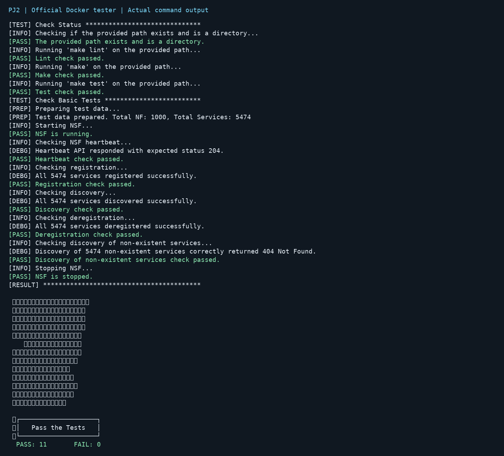
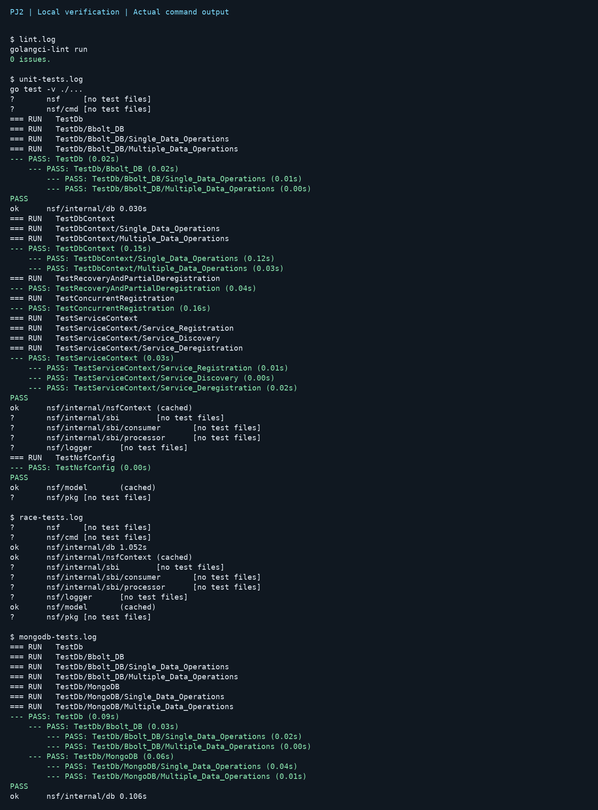
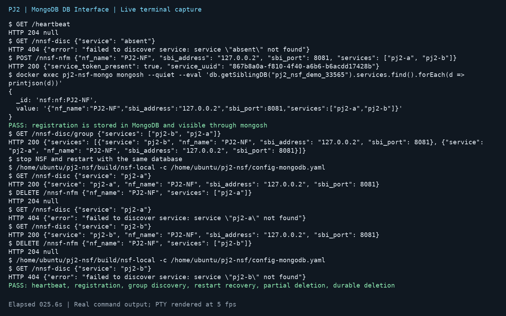

# PJ2 — Network Service Function

- 學號：315552040
- GitHub：https://github.com/AllenHung123/pj2-nsf
- 作業說明：https://cndi-free5gc.github.io/doc-project/pj2/
- 狀態：本機預覽草稿。程式尚未推送 GitHub，尚未繳交；上方連結目前仍是遠端原有版本。

## 實作內容

### Service Context

在 `internal/nsfContext/serviceContext.go` 完成註冊、單一服務查詢、服務撤銷與釋放。

每個 NF 使用 `nsf:nf:<nf_name>` 作為資料庫 key，value 為 JSON，包含 NF 名稱、SBI 位址、port 與 services 清單。這個命名空間也避免和一般 DB interface 測試資料混淆。

註冊時合併同一 NF 的服務清單並去除重複，儲存成功後才回報成功。撤銷時僅移除指定 NF 的指定服務，保留其餘服務；當該 NF 已無服務時才刪除整筆紀錄。不同 NF 提供相同服務時，撤銷其中一個 NF 不影響其他 NF；查詢依 NF 名稱排序選取第一個提供者。

使用 `sync.RWMutex` 保護讀取與更新，避免並行註冊造成資料遺失。查詢直接讀取持久化資料，不依賴啟動前的記憶體狀態，因此 NSF 重啟後仍能查詢服務。`release()` 不清除資料，DB 由原有 dbContext 負責關閉。

原有 processor 已透過單一查詢實作群組查詢，因此完成 Service Context 後即可支援 Group Discovery，並保留輸入順序。

### DB Interface 抽換

在 `internal/db/customDb.go` 以 MongoDB 實作完整 `DbIf`：

`Release`、`Save`、`SaveAll`、`Exist`、`Load`、`LoadAll`、`Remove`、`RemoveAll`。

在 `internal/db/db.go` 加入 `mongodb` 分支，使用 Go 官方 MongoDB driver v2。每次 DB 操作設定 5 秒 timeout；MongoDB `_id` 對應 key，`value` 欄位保存 JSON 字串。連線資訊可由 `NSF_MONGO_URI` 與 `NSF_MONGO_DATABASE` 設定，預設為 `mongodb://127.0.0.1:27017` 及 `pj2_nsf`。

`config.yaml` 保留 `db_type: "bbolt"`，符合助教環境要求。`config-mongodb.yaml` 僅用於本機示範，監聽 `127.0.0.1:18080`。

## 本機驗證

| 檢查 | 結果 |
| --- | --- |
| `make lint` | 通過，0 issues |
| `make` | 通過 |
| `make test` | 通過，包含原始測試與新增恢復、部分撤銷、共用服務、並行註冊測試 |
| `go test -race ./...` | 通過 |
| 官方 `alonza0314/nsf-tester:latest` | 11 PASS、0 FAIL |
| MongoDB DbIf 操作測試 | 通過，使用獨立測試資料庫 |
| bbolt HTTP 整合測試 | 通過，包含群組查詢、重啟恢復、部分撤銷及撤銷後再次重啟 |
| MongoDB HTTP 整合與 mongosh 查詢 | 通過，詳見 `db.mp4` 與操作紀錄 |
| GitHub Actions | 尚未執行此次修改；依使用者要求暫不推送 |

完整輸出見 `artifacts/`。下圖為實際測試輸出排版成的紀錄圖，沒有使用 GitHub Actions 畫面替代本機結果。





## DB 操作錄影

`db.mp4` 錄製實際命令的終端輸出，依執行時間將 PTY 終端畫面轉成 MP4；沒有錄製桌面 GUI。未修改的原始輸出保存在 `artifacts/db.log`。請檢視是否符合課程對螢幕錄影形式的要求。

操作內容依序為：

1. 顯示 `config-mongodb.yaml` 中的 `db_type: "mongodb"`，啟動 NSF。
2. 透過 HTTP 註冊 `PJ2-NF` 的 `pj2-a`、`pj2-b`。
3. 執行容器內的 `mongosh`，直接讀取 MongoDB `services` collection，確認資料確實寫入。
4. 執行群組查詢。
5. 關閉並重啟 NSF，確認可恢復查詢。
6. 只撤銷 `pj2-a`，確認 `pj2-b` 仍存在。
7. 撤銷剩餘服務，再次重啟，確認已刪除服務回覆 404。



## 重現方式

```sh
make
make test
make lint
go test -race ./...
docker run --rm -v "$PWD":/work alonza0314/nsf-tester:latest
```

MongoDB 示範（Docker port 27019 僅對本機開放）：

```sh
docker run -d --rm --name pj2-nsf-mongo \
  -p 127.0.0.1:27019:27017 mongo:8.0
NSF_TEST_MONGODB=1 NSF_MONGO_URI=mongodb://127.0.0.1:27019 \
  go test -v ./internal/db
CGO_ENABLED=0 go build -o build/nsf-local main.go
NSF_BINARY="$PWD/build/nsf-local" python3 scripts/check_api.py --backend mongodb
# 測試完成後停止示範容器：
docker stop pj2-nsf-mongo
```

bbolt 的 HTTP 測試可執行 `python3 scripts/check_api.py --backend bbolt --port 18081`。因原有 bbolt 使用固定 `/tmp/nsf.db`，腳本遇到既有資料檔會停止，避免覆蓋資料；請先自行備份或移走既有資料。

官方測試容器會重新產生 `build/nsf`。若容器與主機 glibc 版本不同，可用上述 `CGO_ENABLED=0` 指令建立獨立的本機執行檔，並透過 `NSF_BINARY` 指定。

## 限制與待辦

- 官方測試器只驗證其公開項目。群組查詢與恢復另有本機測試，但沒有取得助教隱藏測資，無法保證隱藏測試成績。
- 服務查詢目前讀取所有 NF 紀錄並排序，效能約為 O(N log N)，適合作業規模；大型部署可另加服務索引。
- MongoDB 的 `SaveAll` 是 bulk write，沒有跨多筆文件的交易保證；Service Context 每次修改一份 NF 文件，因此不依賴跨文件交易。
- 待使用者檢閱後，才決定是否推送 GitHub、啟用／檢查 Actions，並補充 Actions 真實執行畫面。此預覽 ZIP 不應直接當成已完成遠端驗證的正式繳交版。
